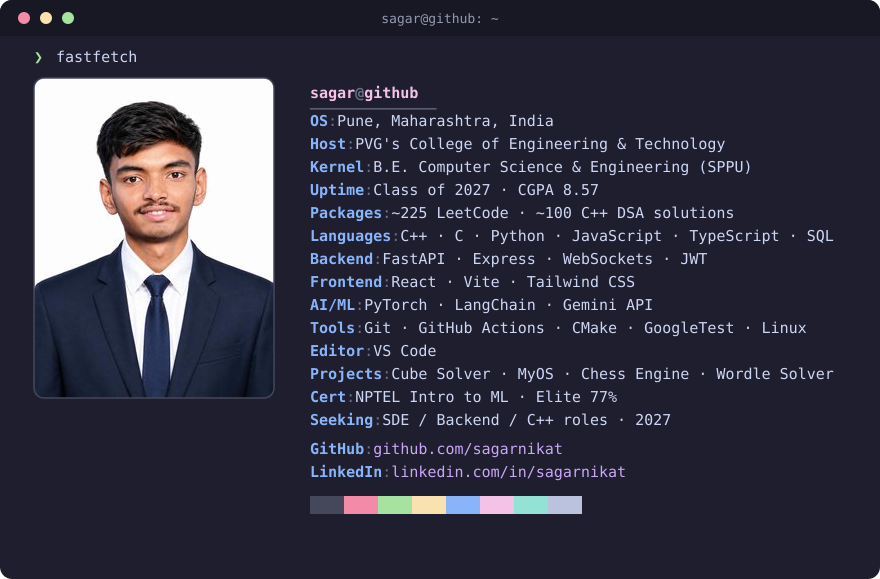

  

<h3 align="center">⚙️ Systems · Algorithms · Backend</h3>

  
  

## 🧪 Featured projects

| Project | What it is | Stack |
| --- | --- | --- |
| [**Rubik's Cube Solver**](https://github.com/sagarnikat/Rubiks_Cube_Solver) | Kociemba two-phase solver from scratch, IDA\* search, multithreaded, terminal UI | C++20 · CMake · GoogleTest |
| [**MyOS**](https://github.com/sagarnikat/own_os) | Bare-metal x86 OS that boots into a graphical desktop with a window manager | C++ · x86 asm · GRUB · SDL2 |
| [**Wordle Solver**](https://github.com/sagarnikat/wordle_solver) | Entropy-based solver, 2.64 average guesses across all 2,309 answers | C++17 · CMake |
| [**CodeSync**](https://github.com/sagarnikat/CodeSync) | Browser extension that commits accepted LeetCode solutions to GitHub | TypeScript · Manifest V3 · Vite |
| [**ChessArena**](https://github.com/sagarnikat/chess_web) | Real-time multiplayer chess with spectators and server-side clocks | React · FastAPI · WebSockets |
| [**AI Job Description Writer**](https://github.com/sagarnikat/job-discription) | Generates JDs with salary and SEO suggestions, exports PDF/DOCX | React · FastAPI · LangChain · Gemini |

## 🛠️ Tech stack

  
  
  
  
  
  
  
  
  
  
  
  

## 📊 Stats

  
  

## 🐍 Contribution snake

  <picture>
    <source media="(prefers-color-scheme: dark)" srcset="https://raw.githubusercontent.com/sagarnikat/sagarnikat/output/github-snake-dark.svg"/>
    <source media="(prefers-color-scheme: light)" srcset="https://raw.githubusercontent.com/sagarnikat/sagarnikat/output/github-snake.svg"/>
    
  </picture>

